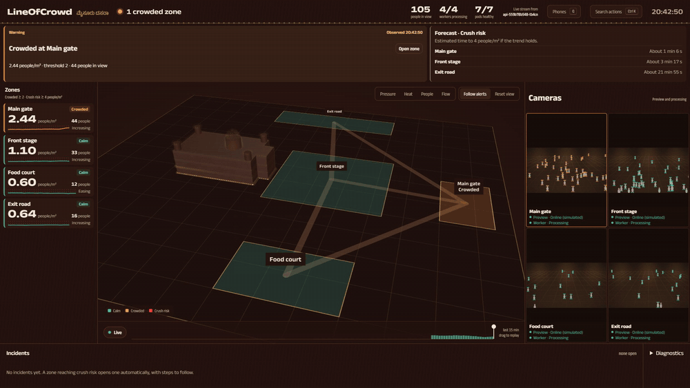
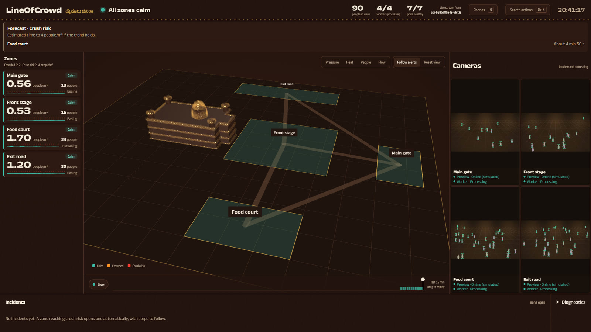
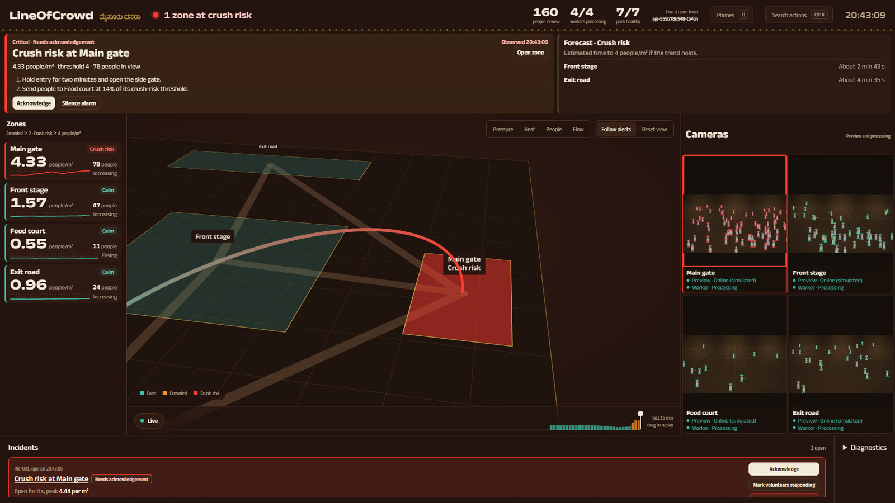
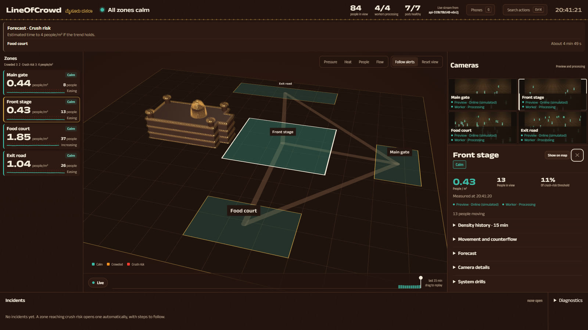
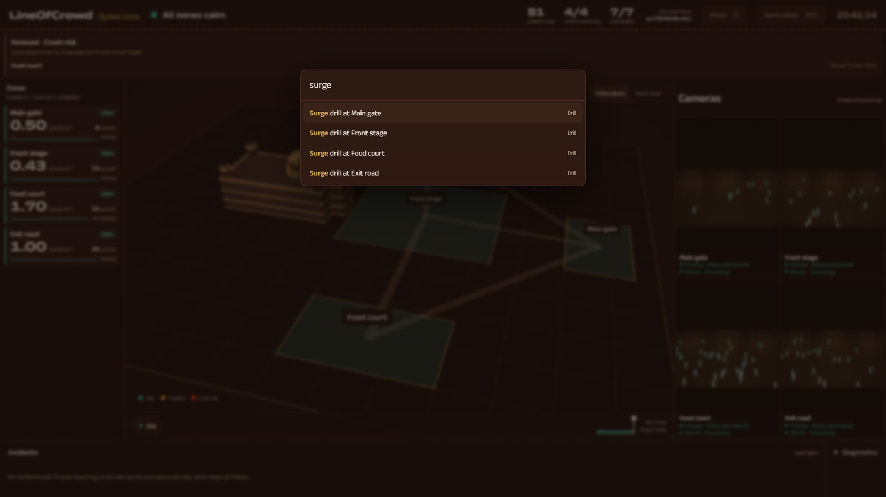
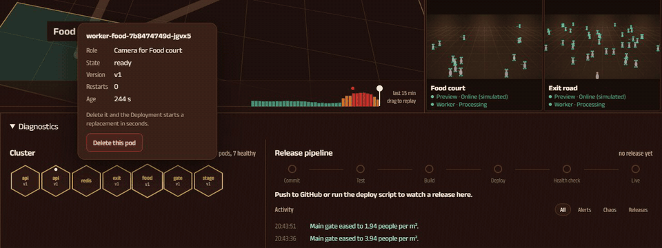
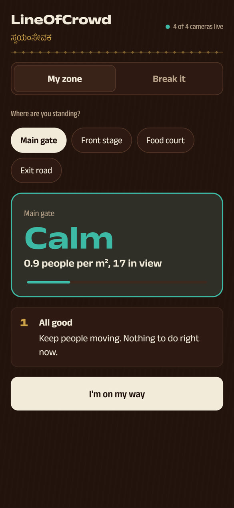
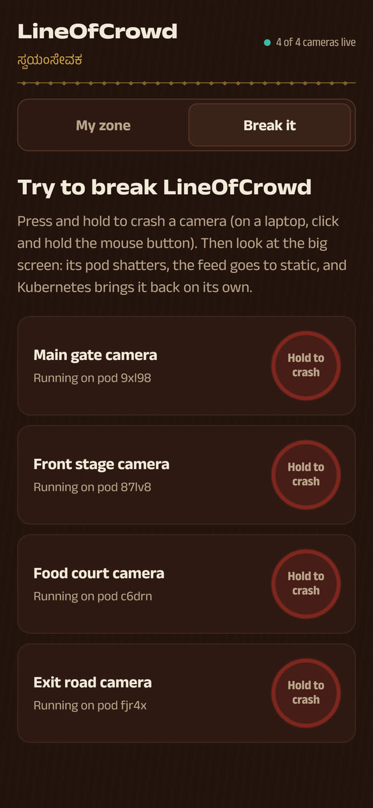
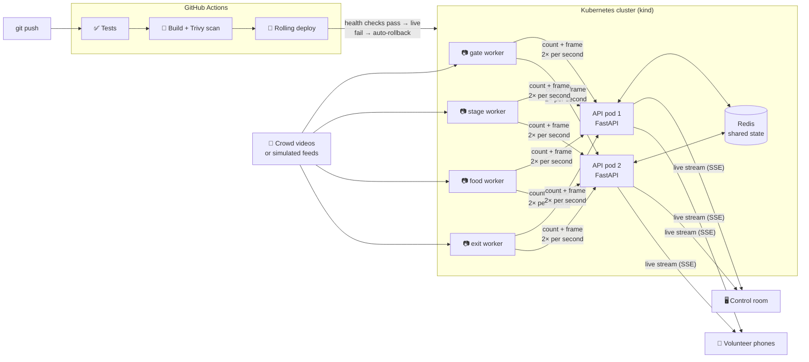

<div align="center">

# LineOfCrowd

### Crowd-crush early warning for big events, built to never go down.

AI cameras count the crowd at Mysuru Dasara, warn the control room before a zone gets dangerous,<br>
and keep running even when cameras crash, servers die or a bad update ships.

[](https://github.com/Yojithn/LineOfCrowd/actions/workflows/pipeline.yml)




<sub>A surge drill at the Main gate: calm → crowded → <b>crush risk</b>. The map flies to the zone, draws where to send people, and opens an incident.</sub>

</div>

---

## Why this exists

Stampedes don't happen out of nowhere. Crowd density creeps up, and at around **4–5 people per m²** a crowd
stops being able to move on its own. The problem is that nobody watching the cameras notices in time.

LineOfCrowd watches every zone for them. It counts people with a YOLO model, works out **people per m²**,
forecasts **when** each zone will hit crush risk, and tells the control room exactly what to do.

And because a safety system that goes offline during a stampede is useless, every part of it runs on
**self-healing Kubernetes**: crashed cameras come back in seconds, a dead server hands its viewers to its twin,
and a broken release rolls itself back.

## Highlights

<table>
<tr>
<td width="50%" valign="top">

### 🗺️ Live 3D control room
A 3D map of the Mysuru Palace grounds with a pressure column per zone, live camera feeds,
a 30-minute forecast and a 15-minute replay strip you can drag back through.

</td>
<td width="50%"></td>
</tr>
<tr>
<td width="50%"></td>
<td width="50%" valign="top">

### 🚨 Alerts that tell you what to do
When a zone crosses the crush-risk line, the screen goes red, a voice announces it, the map draws a
**redirect arc** to the calmest nearby zone, and an **incident** opens with Acknowledge → Send volunteers → Resolve.

</td>
</tr>
<tr>
<td width="50%" valign="top">

### 🔍 Drill into any zone
Click a zone for its live feed, density history, flow direction and counter-flow (an early sign of turbulence),
forecast, and the actions an operator can take.

</td>
<td width="50%"></td>
</tr>
<tr>
<td width="50%"></td>
<td width="50%" valign="top">

### ⌨️ Keyboard-first
**Ctrl K** opens a command menu for every action: open a zone, run a surge drill, crash a camera,
toggle map layers, change danger levels or show the QR code for phones.

</td>
</tr>
</table>

### ♻️ Self-healing: delete a camera pod and watch it come back



<sub>Each camera is its own Kubernetes pod. Delete one from the Cluster panel and the Deployment replaces it in about 3 seconds. The other cameras never stop.</sub>

### 📱 Volunteer phones

<table>
<tr>
<td align="center" width="50%"><br><sub><b>My zone:</b> one glance at your zone's status, and an <i>I'm on my way</i> button that shows up in the control room</sub></td>
<td align="center" width="50%"><br><sub><b>Break it:</b> judges and visitors press and hold to crash a real camera pod, then watch it heal on the big screen</sub></td>
</tr>
</table>

## How it works



- **One pod per camera.** Each worker runs YOLOv8n (ONNX Runtime, no PyTorch), tracks movement and reports twice a second. If one crashes or freezes, only that camera blinks, and Kubernetes restarts it.
- **Two API pods** share state through Redis. Kill the one serving your dashboard and the live stream reconnects to the other.
- **Zero-downtime releases.** A new version must pass its health checks before an old pod is removed. If it never does, the release times out and rolls back on its own.

## Tech stack

| Layer | Tools |
|---|---|
| Detection | YOLOv8n exported to ONNX, ONNX Runtime, OpenCV, a motion-predictive tracker and crowd-flow classifier |
| Backend | Python 3.13, FastAPI, Server-Sent Events, Redis |
| Frontend | Plain HTML/CSS/JS modules (no build step), deck.gl 3D map |
| Platform | Docker, Kubernetes (kind), RBAC, liveness/readiness probes, rolling updates |
| CI/CD and security | GitHub Actions, Trivy image scanning, self-hosted deploy runner, automatic rollback |

## Quick start

```powershell
# needs Docker Desktop, kind, kubectl and Python 3.13
$env:WORKER_API_KEY   = python -c "import secrets; print(secrets.token_urlsafe(32))"
$env:OPERATOR_API_KEY = python -c "import secrets; print(secrets.token_urlsafe(32))"
$env:PIPELINE_TOKEN   = python -c "import secrets; print(secrets.token_urlsafe(32))"
$env:APP_ENV = "development"; $env:ENABLE_CHAOS = "1"

python scripts\cs.py up      # creates the cluster, builds images, deploys everything
```

Open **http://localhost:8080**, click **Start monitoring**, and press **Shift 1** for a surge drill.
No Kubernetes? `docker compose up --build` runs the same thing on plain Docker.
The full step-by-step guide is below.

> The screenshots and GIFs above use the built-in **simulated camera feeds**. Drop real crowd clips into
> `worker/videos/` and the same pipeline runs YOLO on them instead.

---

## What's in the folder

| Path | What it is |
|---|---|
| `worker/` | Camera worker: reads a video, detects people (YOLOv8n via ONNX Runtime, no PyTorch), tracks movement, reports twice a second |
| `api/` | FastAPI server: density, alerts, forecast, incidents, 15-minute replay history, live stream, chaos tests, pipeline status |
| `api/static/` | The control room and the phone page. Plain HTML/CSS/JavaScript modules, no build step: `js/main.js` wires `scene.js` (3D map), `ledger.js`, `cameras.js`, `drawer.js`, `incidents.js`, `cluster.js`, `pipeline.js`, `replay.js`, `palette.js`, `alarm.js` |
| `api/app/zones.json` | The venue: zone names, map positions, camera area in m², danger thresholds |
| `k8s/` | Kubernetes manifests (namespace, Redis, API with RBAC, 4 camera Deployments with health probes) |
| `kind-cluster.yaml` | Creates the local Kubernetes cluster and opens port 8080 |
| `docker-compose.yml` | Plan B: run everything with plain Docker, no Kubernetes |
| `scripts/cs.py` | One script to set up, release, roll back, check status |
| `.github/workflows/pipeline.yml` | CI/CD pipeline |

---

# Full guide

## 1. One-time setup on Windows

Open **PowerShell** and run these one at a time:

```powershell
winget install -e --id Docker.DockerDesktop
winget install -e --id Git.Git
winget install -e --id Python.Python.3.13
winget install -e --id Kubernetes.kind
winget install -e --id Kubernetes.kubectl
```

Then:

1. Restart the laptop (Docker Desktop needs it the first time).
2. Open **Docker Desktop**, accept the terms, and wait until it shows **Engine running**.
   If it asks about WSL 2, let it install/update WSL.
3. Open a **new** PowerShell window and check everything:

```powershell
python --version
git --version
cd path\to\lineofcrowd
python scripts\cs.py doctor
```

If `python --version` says "Python was not found", install Python from python.org instead and
tick **Add python.exe to PATH** on the first installer screen.

## 2. Add crowd videos (optional but better)

Put up to 4 clips in `worker\videos\` named `gate.mp4`, `stage.mp4`, `food.mp4`, `exit.mp4`.
Free clips: search "crowd" or "festival crowd" on Pexels or Pixabay. Clips filmed from high up count
best. Keep each under about 30 MB so GitHub accepts them, and commit them to the repo.
Any camera without a video runs a **simulated feed**, so the demo works even with zero videos.

**Tip:** leave Main gate without a video. Its simulated feed surges to crush risk every 2.5 minutes
and on demand (**Shift 1**, or **Ctrl K** → "Surge drill at Main gate"), which guarantees the red-alert moment during the demo. Use real clips
for the other three zones.

Counts look too low or high? Change `area_m2` for that zone in `api\app\zones.json`
(smaller area = higher density), then run `python scripts\cs.py up` again.

## 3. Run it on Kubernetes (the main demo)

Set the local demo credentials in PowerShell before bringing up Kubernetes or Compose.
Generate these once for the session and keep the values private.

```powershell
$env:WORKER_API_KEY = python -c "import secrets; print(secrets.token_urlsafe(32))"
$env:OPERATOR_API_KEY = python -c "import secrets; print(secrets.token_urlsafe(32))"
$env:PIPELINE_TOKEN = python -c "import secrets; print(secrets.token_urlsafe(32))"
$env:APP_ENV = "development"
$env:ENABLE_CHAOS = "1" # Optional for the crash, delete-pod and surge drills
```

```powershell
python scripts\cs.py up
```

The setup script supplies the credentials through the `api-auth` Kubernetes Secret and the demo
flags through the `api-config` ConfigMap. For an existing cluster, run `up` once with matching
credentials before using the rolling-release command so the deployments receive the new configuration.

The first run takes about 5–10 minutes (it creates the cluster and builds the images). Later runs are
quick. When it finishes it prints two addresses:

- **Dashboard:** http://localhost:8080. Open it in Chrome or Edge, press F11 for full screen,
  and click **Start monitoring**. The click is needed because browsers block sound until you click.
- **Phones:** `http://<laptop-ip>:8080/m`. Phones and laptop must be on the **same Wi-Fi or hotspot**.
  Press **Q** on the dashboard (or the **Phones** button) to show a big QR code for this address.
  The laptop's address changes whenever it joins a different Wi-Fi or hotspot. After switching,
  run `python scripts\cs.py phone` so the QR code points at the new address.

Other commands:

```powershell
python scripts\cs.py status        # list pods
python scripts\cs.py logs gate     # one camera's logs
python scripts\cs.py down          # delete the cluster
```

**Plan B (no Kubernetes):** `docker compose up --build`, then open http://localhost:8080.
Everything works, and crashed cameras are restarted by Docker instead of Kubernetes.
Run `python scripts\cs.py down` first if the cluster is using port 8080.

### Operator sign-in and API configuration

Open `/api/operator?next=/` in a browser tab on the **same origin** as the dashboard (for example,
http://localhost:8080/api/operator?next=/), or `/api/operator?next=/m` for the phone page. In the
browser prompt, use `operator` as the username and the value of `OPERATOR_API_KEY` as the password.
The browser then goes straight back to the dashboard or phone page. If you forget, any operator
action shows a **Sign in** link (on the phone page it opens the sign-in prompt by itself). Each browser needs its own sign-in for settings changes, incident actions,
or enabled drills. The browser session expires after eight hours. Public monitoring, including
camera frames, replay, and the live stream, remains accessible without a sign-in.

| Setting | Purpose |
|---|---|
| `WORKER_API_KEY` | Give the same value to the API and camera workers. Workers send `Authorization: Bearer <worker key>` on `POST /api/report`. |
| `OPERATOR_API_KEY` | Give this separate value to the API and trusted operators. API clients use `Authorization: Bearer <operator key>` for settings writes, incident actions, and enabled drills. |
| `PIPELINE_TOKEN` | Set a third value on the API and in the release CLI environment or GitHub Actions secret of the same name. The CLI sends `X-Pipeline-Token`. Pipeline writes are closed when this value is absent. |
| `APP_ENV`, `ENABLE_CHAOS` | The API defaults to production and refuses to start without both role keys. Chaos routes are available only with `APP_ENV=development` and `ENABLE_CHAOS=1`. Authentication applies in development too. |
| `MAX_PERSON_COUNT`, `MAX_FRAME_BYTES` | API limits for the camera count and decoded JPEG size. Defaults are 10,000 people and 524,288 bytes. The JSON body also has a cap based on the encoded frame limit plus 32 KiB for metadata. |

Supply distinct randomly generated credentials through the environment or your secret manager.
Use HTTPS for production dashboard and worker traffic. If TLS terminates at a reverse proxy,
configure Uvicorn to trust forwarded headers from that proxy so browser origin checks see the
public HTTPS origin. Keep public read endpoints behind network access controls if feeds or incident
details are sensitive. A shared worker key authorizes reporting, while Compose and Kubernetes
check that the reported worker name belongs to the selected zone.

Camera reports are JSON. `zone`, integer `count`, `pod` and `version` are required. Numeric
metrics must be finite, position points contain `[x, y, vx, vy]` with normalized coordinates, and
optional frames use standard base64 JPEG. Unknown zones return `404`, malformed JSON returns
`400`, invalid fields or frames return `422`, and reports above the body limit return `413`.
Requests that need Redis return `503` when the service is unavailable. Workers continue with the
next frame after a failure. Avoid automatically replaying a failed write because the datastore may
have applied it before the connection failed.

### Using the control room

| Do this | What happens |
|---|---|
| Click a zone on the map, in the zone list, or a camera | The zone drawer opens: live feed, 15-minute chart (hover to read any moment), a flow rose showing which way people move, forecast, and actions |
| **Ctrl K** (or **/**) | Command menu: type to find any action (open a zone, crash a camera, surge drill, layers, replay, danger levels, QR code) |
| Map buttons: Pressure, Heat, People, Flow | Turn the 3D layers on and off (keys **C H P F**). Drag to pan, right-drag to rotate |
| Drag along the strip under the map | Replay the last 15 minutes. Bars show how crowded the venue was; dots mark alerts, crashes and releases. **← →** step, **L** back to live |
| Incidents panel | Every crush-risk alert opens an incident. **Acknowledge**, **Send volunteers**, **Resolve**. Volunteers can tap **I'm on my way** on their phones and it shows up here |
| Click a hexagon in the Cluster panel | Pod details, and **Delete this pod**. Deleting an API pod moves the live stream to the other one (watch "Live stream from" in the top bar) |
| Ctrl K, then "Change danger levels" | Slide the crowded and crush-risk levels; the preview says which zones would change. Applies to every screen |
| **?** | All keyboard shortcuts |

## 4. Connect GitHub Actions (CI/CD)

The test and build jobs run on GitHub's servers. The **deploy** job runs on this laptop, because the
cluster lives here. Set the laptop up as a "self-hosted runner":

1. Push this folder to the GitHub repo (`main` branch).
2. On GitHub: **Settings → Actions → Runners → New self-hosted runner → Windows**.
3. Run the commands GitHub shows in PowerShell, in a folder **outside** the project, like `C:\actions-runner`.
   When it asks *"Would you like to run the runner as service?"* answer **N**.
4. Start it with `.\run.cmd` and keep that window open during the expo.
5. On GitHub: **Settings → Secrets and variables → Actions**.
   - Under **Secrets**, add `PIPELINE_TOKEN` with the same value as on the laptop.
   - Under **Variables**, add `DEPLOY_ENABLED` = `true`.

   Until `DEPLOY_ENABLED` is set, pushes still run the tests and the image build and scan,
   and the deploy job is skipped instead of waiting forever for a runner.

Now:

- Every `git push` to `main` runs tests, builds and scans the images, rebuilds them on the
  laptop, and does a rolling update. The dashboard's **Release pipeline** panel lights up stage by stage.
- **Actions → LineOfCrowd pipeline → Run workflow** lets you release on demand. You can do this
  from your phone's browser too. Tick **broken** to ship a corrupted model on purpose.

## 5. Expo demo script (about 5 minutes)

**Before judges arrive:** run `python scripts\cs.py up`, open the dashboard full screen, click
**Start monitoring** (the palace lights up), and press **Q** so visitors can scan the QR code.

1. **The problem (30 s).** "Stampedes happen when crowd density climbs and nobody notices in time.
   At around 4–5 people per m², a crowd can crush people. Mysuru Dasara pulls huge crowds every year."
2. **It watches the crowd.** Point at the camera feeds with boxes around people, the 3D map with
   one pressure column per zone, and the 30-minute forecast.
3. **Crush risk.** Press **Shift 1** to start a surge drill at Main gate (simulated camera), or wait,
   because it surges on its own every 2.5 minutes. About 10 seconds later (orange after ~3 s) the zone turns red, the alarm
   and voice go off, the map flies there, the redirect arc shows where to send people, an incident
   opens, and volunteers' phones vibrate. Click **Acknowledge**, and have a judge tap
   **I'm on my way** on the phone page: it appears in the incident's timeline.
4. **Look back.** Drag the replay strip to the moment before the surge. The map and zone list show
   the venue as it was. Press **L** to come back to live.
5. **Try to break it.** Hand a judge the phone (**Break it** tab, press and hold) or click a camera's
   hexagon and **Delete this pod**. The hexagon shatters, the feed shows *No signal*, and Kubernetes
   brings it back. The tile and the phone show exactly how many seconds that took.
6. **Kill the server itself.** Click an **api** hexagon and delete it. The dashboard keeps going:
   the stream reconnects to the other API pod (the name next to "Live stream from" changes).
7. **Zero-downtime release.** Run the workflow with version `v2` (or
   `python scripts\cs.py deploy --version v2`). The tiles switch from v1 to v2 and no camera goes dark.
8. **A bad release.** Run it again with version `v3` and **broken** ticked (or
   `python scripts\cs.py deploy --version v3 --broken`). New pods start, fail their health checks
   and blink red. After about 30 seconds the pipeline marks the release as failed and rolls back
   automatically. The old cameras kept running the whole time.

Close with: *"A crowd-safety system can't go down during a stampede. Ours heals itself, ships
updates without downtime, and refuses bad releases on its own."*

Keys: **Enter** start, **1–4** open a zone, **Shift 1–4** surge drill (simulated cameras), **Ctrl K** command
menu, **Q** QR code, **L** live, **R** reset map, **M** voice on or off, **?** all shortcuts.

## 6. DevOps concepts, and where they are

| Concept | Where to point |
|---|---|
| Version control, branching | Git + GitHub repo |
| Continuous integration | `test` and `build-and-scan` jobs in `pipeline.yml` |
| Continuous delivery / deployment | `deploy` job → `scripts/cs.py deploy` |
| Containers | `api/Dockerfile`, `worker/Dockerfile` (non-root users, slim images) |
| Orchestration | `k8s/` Deployments, Services, NodePort |
| Infrastructure as Code | `kind-cluster.yaml` + `k8s/*.yaml` recreate the whole system from files |
| Self-healing | Pods restarted by Deployments; liveness probe restarts frozen cameras |
| Health checks | Readiness and liveness probes (heartbeat file for cameras, `/readyz` for the API) |
| Rolling updates, zero downtime | `maxUnavailable: 0`, `maxSurge: 1`, `minReadySeconds` |
| Automatic rollback | `progressDeadlineSeconds` + `kubectl rollout undo` in `cs.py` |
| High availability | 2 API replicas behind one Service, shared state in Redis. Delete one from the dashboard and the live stream (Server-Sent Events) reconnects to the other |
| Least privilege / RBAC | `k8s/20-api.yaml`: the API can only list/delete pods in its own namespace |
| DevSecOps | Trivy image scan in CI |
| Observability | Live dashboard: pod states, restarts, versions, events log, 15-minute replay |
| Chaos engineering | Delete any camera or API pod from the Cluster panel, and the phone's **Break it** tab |
| Incident management | Incidents open automatically, with acknowledge, respond and resolve steps |

## 7. Questions judges may ask

- **Why not one big server?** One crash would blind every camera. Here each camera is isolated,
  and Kubernetes replaces any that fail.
- **How do you count density?** People counted by YOLO ÷ the ground area the camera sees (m²).
  Below 2 is calm, 2–4 crowded, and 4+ crush risk, in line with crowd-safety research.
- **What stops a bad update?** The new pod must pass its health check before the old one is removed.
  If it never does, the release times out and `kubectl rollout undo` restores the previous version.
- **How is the forecast made?** A straight-line trend over the last 45 seconds of density, which gives
  an estimate of when the zone will reach crush risk.
- **What is counter-flow?** People moving in opposite directions in a packed zone, an early sign of
  turbulence. Worked out from tracked movement directions.

## 8. Troubleshooting

| Problem | Fix |
|---|---|
| `python` not found | Reinstall Python from python.org with **Add python.exe to PATH**, open a new PowerShell |
| `doctor` says Docker isn't running | Open Docker Desktop and wait for **Engine running** |
| Port 8080 already in use | `docker compose down`, or close whatever uses 8080 |
| Pods stuck in `ImagePullBackOff` | Images weren't loaded. Run `python scripts\cs.py up` again |
| Phones can't open the page | 1) Run `python scripts\cs.py phone` (the laptop's address may have changed) and rescan the QR code. 2) Same Wi-Fi or hotspot for phone and laptop; turn off VPN apps on the phone. 3) Test with a phone that is **joined to** the hotspot, not the phone **sharing** it: the sharing phone often cannot open pages on its own clients. 4) Chrome on iPhone: Settings → Chrome → turn on **Local Network**. 5) In admin PowerShell: `New-NetFirewallRule -DisplayName LineOfCrowd -Direction Inbound -Protocol TCP -LocalPort 8080 -Action Allow` |
| Most reliable demo network | Turn on the laptop's own hotspot (Settings → Network → **Mobile hotspot**), join the phones to it, then run `python scripts\cs.py phone`. Phones then reach the laptop at `192.168.137.1` with no router in between |
| QR code says phones can't open localhost | Run `python scripts\cs.py phone` while connected to the hotspot, or `phone --public-url http://<ip>:8080` |
| 3D map is blank | Use Chrome or Edge with hardware acceleration on (Settings → System) |
| No voice | Click **Start monitoring** first (browsers block sound until a click), then press **M** to toggle voice |
| GitHub deploy job waits forever | The runner window (`run.cmd`) is closed. Start it again |

## Team

LineOfCrowd was built as a team project for our DevOps expo by
**[Yojithn](https://github.com/Yojithn)** and **[astronaut-63](https://github.com/astronaut-63)**.
The commit history shows who built what.

## Credits

Person detection uses Ultralytics YOLOv8n (AGPL-3.0) exported to ONNX. 3D map uses deck.gl (MIT).
Fonts: Anek Latin and Anek Kannada by Ek Type (SIL Open Font License).
